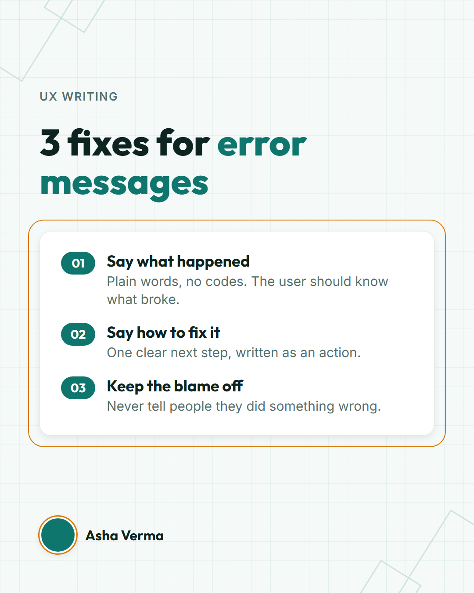
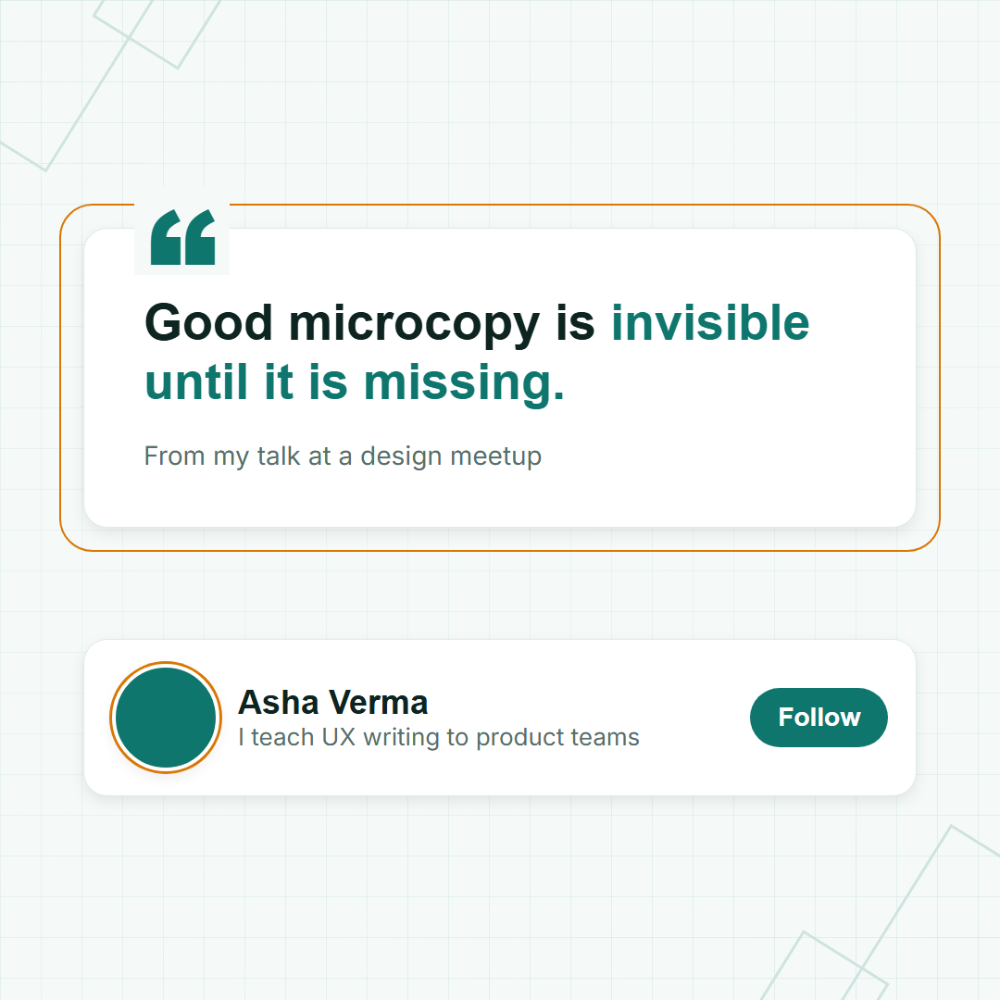

# Post Graphics Skills for Claude

Three Claude skills that turn your post text into on-brand social media graphics and looping GIFs.

## Install in one step: give this prompt to Claude Code

Copy this, paste it into Claude Code (terminal, desktop app or VS Code), and press Enter. Claude does the rest. Click **Allow** when it asks.

```text
Install the post-graphics skills for me and get them ready to use:
1. Run: npx -y skills add <your-github-name>/post-graphics-skills -g -a claude-code -s '*' -y --copy
   If Node.js is missing, tell me in plain words how to install it, then try again.
   If npx fails for another reason, download https://github.com/<your-github-name>/post-graphics-skills
   and copy the three folders inside skills/ into ~/.claude/skills/.
2. Run the one-time setup: node ~/.claude/skills/post-graphic/scripts/setup.mjs
   Wait until it prints READY.
3. Tell me in plain words that it worked, that I may need to start a new session,
   and that I can now say "Set up my brand kit".
```

**Prefer the terminal?** One line:

```
npx skills add <your-github-name>/post-graphics-skills
```

Or install one at a time: `npx skills add <your-github-name>/post-graphics-skills --skill post-graphic`. Needs Node.js 18 or newer. Works with Claude Code and other coding agents. Using the Claude app or claude.ai instead? See [Install](#install).

| Skill | What it does | Say something like |
|---|---|---|
| **post-brand-kit** | Sets up your colours, fonts, style and background pattern once, and saves them as `brand-kit.md`. Can update it and preview it later. | "Set up my brand kit", "Change my accent colour to green", "Show my brand kit" |
| **post-graphic** | Turns your post into a designed PNG: explainer, story or quote, portrait or square. Shows you a plan first, checks its own work, then improves it round by round. | "Make a graphic for this post: …" |
| **post-animator** | Turns that graphic into a short looping GIF: a number counting up, points lighting up one by one, a soft pulse on your photo. | "Animate this graphic" |

<p>
  
  
  
  
</p>

*Made with a sample brand for a made-up person, "Asha Verma".*

No brand kit yet? `post-graphic` still works. It asks 4 quick questions and offers to save your answers as a kit.

The design rules come from many rounds of real LinkedIn graphics. Examples: never a plain background, subtle shadows only, no text under 26 px, one idea per block, and no "AI look" (purple gradients, glowing orbs). Count-ups never start from 0, and colours never flicker in the GIF. All the words on a graphic come from you. The skills never invent numbers or claims.

## Install

### Claude app or claude.ai (Free, Pro, Max, Team, Enterprise)

1. Download the three zips from the [Releases page](../../releases): `post-brand-kit.zip`, `post-graphic.zip`, `post-animator.zip`.
2. In Claude, go to **Settings → Capabilities** and turn on **Code execution and file creation**.
3. Go to **Customize → Skills**, click **+**, choose **Upload a skill**, and upload each zip. Don't unzip them first.
4. Start a chat and say "Set up my brand kit".
5. Claude gives you `brand-kit.md` to download. Make a **Project**, add the file to its knowledge, and make your graphics in chats inside that project, so Claude always has your kit. (Or attach the file whenever you ask for a graphic.)

Skills you upload are private to your own account.

### Claude Code (terminal, desktop app or VS Code)

Run this once in your terminal:

```
npx skills add <your-github-name>/post-graphics-skills
```

Pick Claude Code when it asks which agent, then open Claude Code and say **"Set up my brand kit"**. The first time you make a graphic, Claude installs the drawing tool by itself (about a minute, once). Just click **Allow** when it asks.

Not comfortable with a terminal? Use the [one-step prompt](#install-in-one-step-give-this-prompt-to-claude-code) at the top of this page instead.

Prefer Claude Code plugins? This does the same:

```
/plugin marketplace add <your-github-name>/post-graphics-skills
/plugin install post-graphics@post-graphics-skills
```

Your kit is saved as `brand-kit.md` in your project, or as `~/.claude/brand-kit.md` for all projects, and is found automatically.

#### For Claude: how to install these skills

When someone asks you to install this repo:
1. Run `npx -y skills add <your-github-name>/post-graphics-skills -g -a claude-code -s '*' -y --copy`. Leave out `-g` if they asked for this project only.
2. If that fails, download `https://github.com/<your-github-name>/post-graphics-skills/archive/refs/heads/main.zip`, unzip it to a temporary folder, and copy the three folders inside `skills/` (`post-brand-kit`, `post-graphic`, `post-animator`) into `~/.claude/skills/` (or `.claude/skills/` for this project only). Replace older copies with the same names.
3. Run `node ~/.claude/skills/post-graphic/scripts/setup.mjs`. Wait for `READY`. If Node is missing, run `pip install playwright pillow` and `python -m playwright install chromium` instead.
4. Delete any temporary folder you made.
5. Tell them in plain words: it's installed, they may need a new session, and next they can say "Set up my brand kit".

## How rendering works

Each graphic is built as an HTML page and screenshotted with Playwright (Chromium), which the skills install once into `~/.post-graphics` the first time you use them. Anything a browser can show, a graphic can use: Google Fonts, real photos, screenshots in cards, code-editor frames. GIFs are made frame by frame from the same HTML, with one shared colour palette so nothing flickers.

Every script has a Node version (`.mjs`) and a Python version (`.py`) with the same options. If neither can run where you are, the skill gives you the HTML file to open in your browser instead. It will never claim a PNG or GIF exists when it does not.

## What's inside

```
skills/
  post-brand-kit/  SKILL.md, brand-kit-template.md, preview.html, scripts/(setup|render).*
  post-graphic/    SKILL.md, rules.md, templates/(explainer|story|quote).html, scripts/(setup|render).*
  post-animator/   SKILL.md, motion-rules.md, motion.js, scripts/(setup|animate).*
```

Change `rules.md` or `motion-rules.md` to make the skills follow your own taste.

## Your photos and other people's content

- Your photos are only cropped, resized and positioned. They are never edited, and photos of real people are never generated.
- Other people's faces, logos or brands go on a graphic only if you confirm you have the right to use them.

## Build the zips yourself

```
python build.py
```

This writes `dist/post-brand-kit.zip`, `dist/post-graphic.zip` and `dist/post-animator.zip`, each with the skill folder at the root, which is what claude.ai expects.

## Licence

MIT. Use it, change it, share it.
