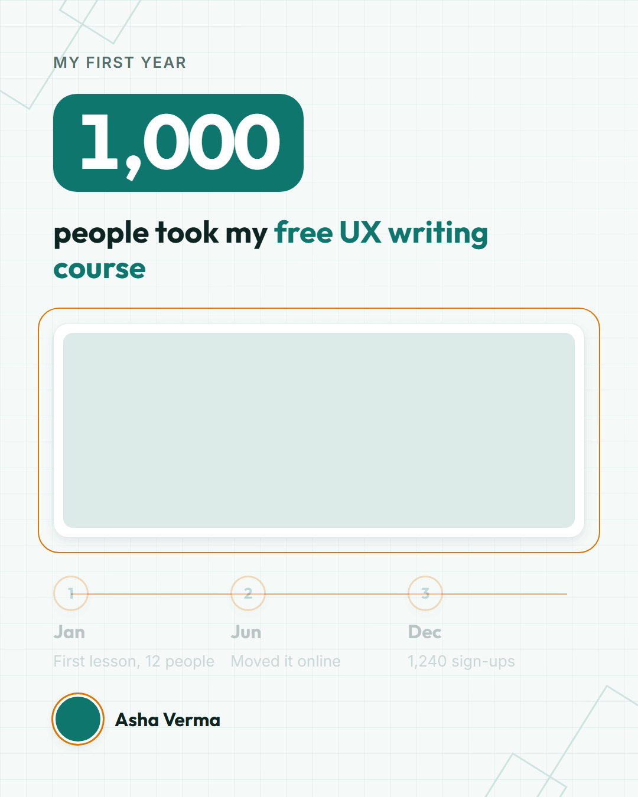
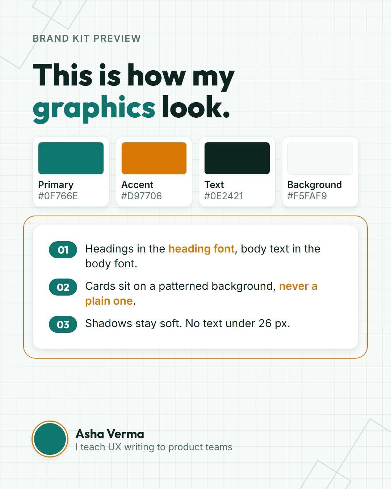

# Post Graphics Skills for Claude

Turn your post text into on-brand social media graphics and looping GIFs, in your own colours and fonts.

<table>
  <tr>
    <td></td>
    <td></td>
    <td></td>
    <td></td>
  </tr>
</table>

*Examples made with a sample brand for a made-up person, "Asha Verma".*

## Install

### Claude Code (terminal, desktop app or VS Code)

**Easiest:** copy this prompt, paste it into Claude Code, and press Enter. Claude installs and sets up everything. Click **Allow** when it asks.

```text
Install the post-graphics skills from
https://github.com/the-mainak-banerjee/post-graphics-skills for all my projects.
Run: npx -y skills add the-mainak-banerjee/post-graphics-skills -g -a claude-code -s '*' -y --copy
Then run the one-time setup: node ~/.claude/skills/post-graphic/scripts/setup.mjs
When it prints READY, tell me in plain words that it worked.
```

**Or use the terminal yourself:**

```
npx skills add the-mainak-banerjee/post-graphics-skills
```

Pick **Claude Code** when it asks which agent. To install just one skill, add `--skill post-graphic` (or `post-brand-kit`, `post-animator`). The first time you make a graphic, Claude installs the drawing tool by itself. It takes about a minute, once.

You need [Node.js](https://nodejs.org) 18 or newer. After installing, start a new Claude Code session if the skills don't show up.

### Claude app or claude.ai

Works on Free, Pro, Max, Team and Enterprise.

1. Download `post-brand-kit.zip`, `post-graphic.zip` and `post-animator.zip` from the [latest release](https://github.com/the-mainak-banerjee/post-graphics-skills/releases/latest).
2. In Claude, go to **Settings → Capabilities** and turn on **Code execution and file creation**.
3. Go to **Customize → Skills**, click **+**, choose **Upload a skill**, and upload each zip. Don't unzip them first.

Skills you upload are private to your account.

## Use it

1. **Set up your brand kit.** Say "Set up my brand kit". Claude asks 8 short questions: name, colours, light or dark, fonts, size, photo, background pattern, and your do's and don'ts.
2. **Make a graphic.** Say "Make a graphic for this post:" and paste your post. Claude shows you a plan first, then builds the PNG, checks it, and changes it until you're happy.
3. **Animate it.** Say "Animate this graphic". Claude suggests what should move, then makes a looping GIF.

| Skill | What it does | Say something like |
|---|---|---|
| **post-brand-kit** | Saves your colours, fonts, style and background as `brand-kit.md`. Can update it or show a preview later. | "Set up my brand kit", "Change my accent colour to green", "Show my brand kit" |
| **post-graphic** | Turns your post into a designed PNG: explainer, story or quote, portrait or square. | "Make a graphic for this post: …" |
| **post-animator** | Turns that graphic into a short looping GIF: numbers counting up, points lighting up one by one, a soft pulse on your photo. | "Animate this graphic" |

No brand kit yet? `post-graphic` still works. It asks 4 quick questions and offers to save your answers as a kit.

**Where your kit lives:**
- **Claude Code:** saved as `brand-kit.md` in your project, or `~/.claude/brand-kit.md` for all projects, and found automatically.
- **Claude app:** Claude gives you `brand-kit.md` to download. Add it to a **Project's** knowledge and make your graphics in that project, or attach it whenever you ask for a graphic.

## Design rules built in

These come from many rounds of real LinkedIn graphics:
- never a plain background, and only subtle shadows
- no text under 26 px, and one idea per block
- no "AI look", such as purple gradients or glowing orbs
- count-ups never start from 0, and colours never flicker in the GIF

All the words on a graphic come from you, and the skills never invent numbers or claims. Your photos are only cropped, resized and positioned, never edited, and photos of real people are never generated. Other people's faces, logos or brands go on a graphic only if you confirm you have the right to use them.

Want different taste? Edit `rules.md` (graphics) or `motion-rules.md` (GIFs) in the skill folders.

## How it works

Each graphic is an HTML page screenshotted with Playwright (Chromium). The skills install it once into `~/.post-graphics`. Anything a browser can show, a graphic can use: Google Fonts, real photos, screenshots in cards, code-editor frames. GIFs are made frame by frame from the same HTML, with one shared colour palette.

Every script has a Node version (`.mjs`) and a Python version (`.py`). If neither can run, the skill gives you the HTML file to open in your browser. It never claims a PNG or GIF exists when it doesn't.

```
skills/
  post-brand-kit/  SKILL.md, brand-kit-template.md, preview.html, scripts/
  post-graphic/    SKILL.md, rules.md, templates/, scripts/
  post-animator/   SKILL.md, motion-rules.md, motion.js, scripts/
```

To rebuild the claude.ai zips: `python build.py` (writes them to `dist/`).

## Licence

MIT. Use it, change it, share it.
